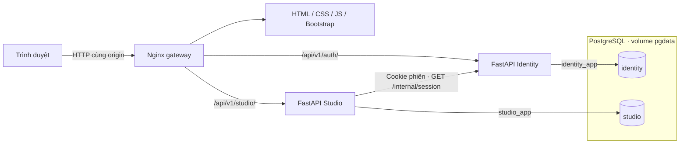
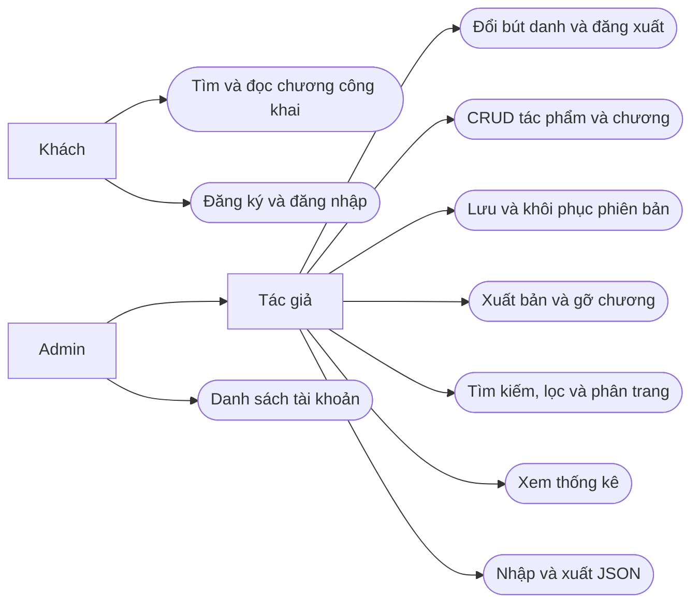
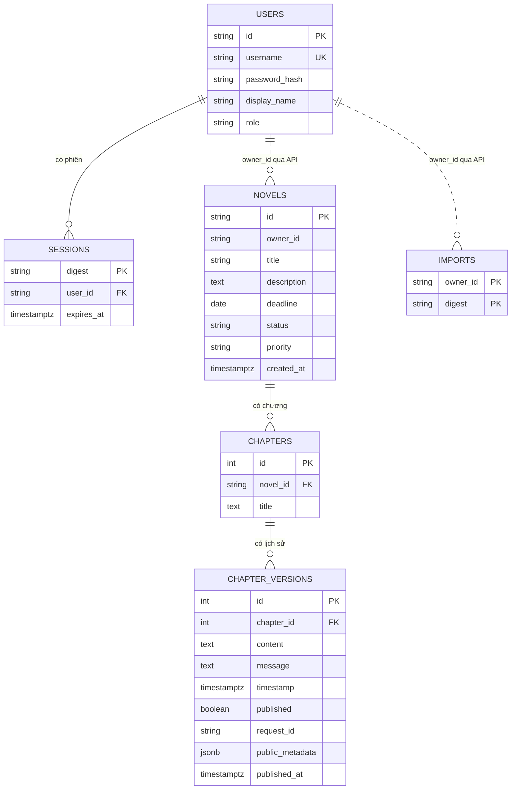

# Kiến trúc và hợp đồng API

Người viết cần giữ được nhiều bản của cùng một chương qua các lần mở trình duyệt, dùng nhiều thiết bị và quyết định bản nào độc giả được xem. Trang chủ dành cho khách. Dashboard và thống kê thuộc về tài khoản hiện hành. Admin có thêm quyền xem danh sách tài khoản.

## Thành phần trên máy chủ Windows

Gateway phục vụ frontend đã build và chỉ proxy hai tiền tố API công bố cho trình duyệt. Khi container backend được tạo lại, Nginx phân giải lại tên dịch vụ qua DNS của Compose. Identity và Studio dùng Dockerfile, migration và health riêng. PostgreSQL kiểm tra quyền CONNECT theo database. DB credential được truyền riêng cho từng service. Các khóa liên kết sang identity là ID nghiệp vụ ổn định được xác minh qua API.

## Use case

## ERD

Identity sở hữu hai bảng đầu. Studio sở hữu bốn bảng còn lại. Xóa tác phẩm hoặc chương sẽ cascade trong database studio. Ràng buộc duy nhất có điều kiện giới hạn một phiên bản công khai mỗi chương. Cặp `(chapter_id, request_id)` cho phép thử lại cùng lần lưu sau khi mất phản hồi. Mọi thay đổi chương hoặc phiên bản khóa hàng tác phẩm trong giao dịch. Khôi phục nối vào lịch sử một hàng mới.

## Phiên và quyền truy cập

Mật khẩu dùng scrypt và salt ngẫu nhiên theo tài khoản. Identity trả cookie `novelstudio_session` với HttpOnly, SameSite=Lax, thời hạn 7 ngày và Secure theo môi trường HTTPS. Database lưu SHA-256 của token phiên. Đăng nhập thay thế phiên trình duyệt hiện hành, đăng xuất xóa phiên ở server. Role đăng ký là Author. Lệnh quản trị tương tác tạo tài khoản Admin riêng.

Mọi thao tác ghi từ trình duyệt gửi header tùy chỉnh `X-NovelStudio: 1`. Hai API dùng cùng origin và không bật CORS. Một trang khác origin phải vượt qua preflight để đặt header này. Studio chuyển cookie đến địa chỉ identity cấu hình sẵn, timeout 3 giây. Chỉ ID và role trong kết quả xác minh có hiệu lực. Mọi truy vấn thư viện, thống kê, xuất và sửa đều được giới hạn theo chủ sở hữu. Public API có truy vấn riêng chỉ đọc các phiên bản có cờ công khai và metadata đã chụp lúc xuất bản.

## Tuyến API cho trình duyệt

Dùng JSON UTF-8. Các đường dẫn trong bảng được nối sau `/api/v1`. Body ghi được mô tả ở cột cuối. ID chương và phiên bản trong JSON là chuỗi. Trong đường dẫn, thay `{n}`, `{c}`, `{v}` lần lượt bằng ID tác phẩm, chương và phiên bản.

| Method | Đường dẫn | Quyền và kết quả |
|---|---|---|
| POST | /auth/register | Khách tạo Author với username, password. Trả 201. |
| POST | /auth/login | username, password. Trả hồ sơ và đặt cookie. |
| POST | /auth/logout | Hủy phiên hiện tại và xóa cookie. |
| GET, PATCH | /auth/me | Đọc hồ sơ hoặc sửa displayName. |
| GET | /auth/users | Admin xem ID, username, bút danh và role. |
| GET | /studio/public | Khách đọc các chương công khai. |
| GET | /studio/novels | Danh sách của mình. Trả items và total sau lọc. |
| POST | /studio/novels | Tạo với title, description, deadline (YYYY-MM-DD), priority và status. |
| GET, PUT, DELETE | /studio/novels/{n} | Đọc cây chương/lịch sử, thay metadata hoặc xóa tác phẩm. |
| DELETE | /studio/novels | Xóa thư viện và dấu nhập của tài khoản. |
| POST | /studio/novels/{n}/chapters | Tạo chương với chapterTitle. |
| PUT, DELETE | /studio/novels/{n}/chapters/{c} | Đổi chapterTitle hoặc xóa chương. |
| POST | /studio/novels/{n}/chapters/{c}/versions | Lưu content, commitMessage và requestId tùy chọn. |
| POST | /studio/novels/{n}/chapters/{c}/versions/{v}/restore | Tạo phiên bản mới từ bản lịch sử. |
| PUT | /studio/novels/{n}/chapters/{c}/versions/{v}/publish | Công khai đúng phiên bản được chọn. |
| DELETE | /studio/novels/{n}/chapters/{c}/publication | Gỡ bản công khai của chương. |
| GET | /studio/statistics | Tổng tác phẩm, trạng thái, ưu tiên, tỷ lệ hoàn thành, chương và phiên bản. |
| GET | /studio/export | Toàn bộ cây JSON trong thư viện riêng. |
| POST | /studio/import | Body là mảng tác phẩm. Trả count và duplicate sau giao dịch. |

Danh sách nhận `keyword` (tiêu đề/mô tả), `status` (All/Pending/Done), `priority` (All/Low/Medium/High), `sortBy` (created-desc/deadline-asc/deadline-desc/title-asc), `page` từ 1 và `size` từ 1 đến 100. Mặc định 10 hàng mỗi trang. Phân trang có ID làm tiêu chí phụ để ổn định thứ tự khi trùng ngày.

Các lỗi thường gặp là 401 khi phiên hết hạn, 403 khi thiếu quyền/header bảo vệ ghi, 404 cho tài nguyên riêng không truy cập được, 409 khi trùng username hoặc tái sử dụng mã lưu với nội dung khác, 413 ở gateway khi quá dung lượng, 422 với JSON sai và 503 khi service phụ thuộc chưa sẵn sàng. Thành công của thao tác ghi chỉ trả sau commit. Lỗi nhập sẽ rollback cả dữ liệu lẫn dấu nhập.

Mỗi container có `GET /health`. Hai API kiểm tra kết nối đến bảng sau migration. Gateway có health riêng cho Nginx. `GET /internal/session` chỉ dùng giữa Studio và Identity trên mạng riêng. Các route health backend và introspection không được proxy ra trình duyệt.

## Dữ liệu cũ và hướng phát triển

Cấu trúc tương thích là mảng tác phẩm với `createdAt`, từng chương có `chapterId, chapterTitle, status, versions`, từng phiên bản có `versionId, content, commitMessage, timestamp`. Lịch sử xếp bản mới nhất ở đầu. Studio kiểm tra toàn bộ cấu trúc, chuẩn hóa thời điểm có múi giờ, tính SHA-256 trên dữ liệu chuẩn hóa, giữ dấu nhập theo chủ sở hữu bằng khóa ghép trong cùng giao dịch. Quyền công khai cũ không được kế thừa.

IndexedDB, đồng bộ offline, worldbuilding, cộng tác trực tiếp và tích hợp AI dành cho giai đoạn sau. [Hướng dẫn vận hành](../README.md) · [Kết quả chạy thử](verification.md)
