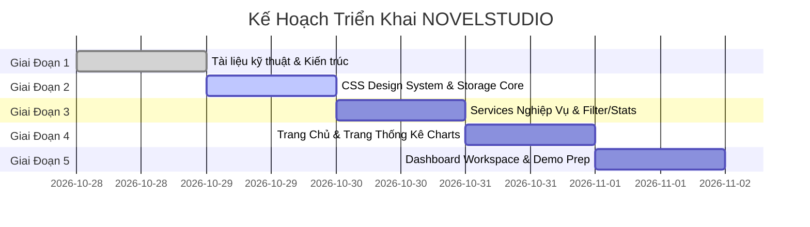

# KẾ HOẠCH TRIỂN KHAI DỰ ÁN & BẢNG ÁNH XẠ RUBRIC CHẤM ĐIỂM
## DỰ ÁN: NOVELSTUDIO (CREATIVE TASK MANAGER)
**Môn học:** Phát triển Ứng dụng Web  
**Mục tiêu:** 100/100 điểm chuẩn + 10 điểm thưởng sáng tạo (Total: 110/100)  
**Tác giả:** Principal Frontend Architect  
**Ngày phát hành:** 2026-10-28  

---

## 1. BẢNG ÁNH XẠ RUBRIC CHẤM ĐIỂM (GRADING MATRIX MAPPING)

| Tiêu Chí Đánh Giá | Điểm Chuẩn | Hiện Thực Hóa Trong NOVELSTUDIO | File Mã Nguồn Tương Ứng |
|---|---|---|---|
| **1. Giao diện & Trải nghiệm (UI/UX)** | **20/20** | Thiết kế cao cấp, hiện đại, Responsive đa màn hình. Hệ thống Dark/Light Mode đồng bộ 100% bằng CSS Variables, không bị lóa hoặc lệch màu. | `assets/css/themes.css` `assets/css/style.css` `assets/css/dashboard.css` |
| **2. Quản lý Tác vụ (CRUD)** | **25/25** | Thêm mới truyện với Modal & Realtime Validation, Sửa thông tin, Xóa từng mục kèm xác nhận SweetAlert2, Xóa tất cả, Đổi trạng thái (Toggle Complete). | `assets/js/services/novelService.js` `assets/js/controllers/dashboardController.js` |
| **3. Xác thực Dữ liệu (Validation)** | **15/15** | Bắt buộc nhập Title (>=3 ký tự), Description (>=10 ký tự), Deadline không được ở quá khứ (>= Hôm nay), Priority & Status hợp lệ. Hiển thị lỗi realtime dưới field. | `assets/js/services/novelService.js` `dashboardController.js` |
| **4. Tìm kiếm, Lọc & Sắp xếp** | **20/20** | Search realtime không phân biệt hoa thường theo Title & Description, Lọc theo Status (All/Pending/Done), Lọc theo Priority, Sắp xếp Deadline (gần/xa), nút Reset. | `assets/js/services/filterService.js` `dashboardController.js` |
| **5. Lưu trữ Bền Vững & Dữ liệu Mẫu** | **20/20** | 100% lưu trữ tại `localStorage`. Tự động khởi tạo dữ liệu mẫu (Seed Data) phong phú ngay lần đầu chạy, không cần nhập liệu thủ công khi chấm thi. | `assets/js/core/StorageAdapter.js` `assets/js/services/novelService.js` |
| **6. ĐIỂM THƯỞNG SÁNG TẠO (BONUS)** | **+10 Điểm** | **Bộ 4 tính năng đột phá:** 1. Hệ thống Quản lý Chương & Kiểm soát Phiên bản Nháp (Git-like Versioning & Restore). 2. Sao lưu và khôi phục toàn diện (Export/Import JSON File). 3. Trung tâm phân tích thống kê đồ thị Chart.js tự đổi theme. 4. Quản lý trạng thái tác giả (User Login/Logout Badge giả lập). | `dashboardController.js` `statistics.html` `statsController.js` `app.js` |
| **TỔNG ĐIỂM MỤC TIÊU** | **110/100** | **Đạt mức Xuất sắc tuyệt đối** | |

---

## 2. KẾ HOẠCH TRIỂN KHAI 5 GIAI ĐOẠN (5 PHASES IMPLEMENTATION PLAN)

---

### GIAI ĐOẠN 1: TÀI LIỆU KỸ THUẬT & ĐẶC TẢ HỆ THỐNG (CURRENT PHASE)
- **Mục tiêu:** Thiết lập nền tảng tài liệu đặc tả toàn diện, chuẩn hóa giao thức dữ liệu và kiến trúc trước khi viết code.
- **Danh sách bàn giao (Deliverables):**
  1. `docs/api_analysis_report.md`: Phân tích API nội bộ, xử lý ngoại lệ và mã lỗi.
  2. `docs/bao-cao-kien-truc-du-an_2.md`: Kiến trúc đa tầng MVC, cơ chế đồng bộ Dark Mode.
  3. `docs/catalog_db_analysis.md`: Đặc tả JSON Schema 3 cấp, bài toán 5MB LocalStorage và XSS defense.
  4. `docs/ke_hoach_trien_khai.md`: Kế hoạch chi tiết và ma trận điểm chấm thi (file này).
  5. `docs/readme.md`: Hướng dẫn vận hành nhanh và kịch bản thuyết trình Demo 3 phút.
- **Tiêu chí nghiệm thu (Acceptance Criteria):**
  - Đầy đủ 5 file, định dạng Markdown chuyên nghiệp, không có lỗi ngữ pháp/cú pháp.

---

### GIAI ĐOẠN 2: THIẾT KẾ GIAO DIỆN & TẦNG LƯU TRỮ CỐT LÕI (CORE & CSS SYSTEM)
- **Mục tiêu:** Xây dựng hệ thống biến màu CSS Tokens, giao diện dùng chung, cơ chế chuyển Theme mượt mà và StorageAdapter an toàn.
- **Danh sách bàn giao:**
  1. `assets/css/themes.css`: Biến màu CSS `:root` & `[data-bs-theme="dark"]`, ghi đè SweetAlert2 và Bootstrap components.
  2. `assets/css/style.css`: Quy chuẩn Navbar, Footer, Typography, Badge, Button animations.
  3. `assets/css/dashboard.css`: Giao diện 2 cột Workspace, Editor Textarea, Version Timeline.
  4. `assets/js/core/StorageAdapter.js`: Bộ điều phối LocalStorage với xử lý JSON parsing & QuotaExceededError.
  5. `assets/js/app.js`: Quản lý chuyển Theme toàn cục, lưu Session người dùng, phát sự kiện `themeChanged`.
- **Tiêu chí nghiệm thu:**
  - Bấm nút Theme chuyển đổi tức thì không giật lóa. Không có class cứng màu (`bg-white`, `text-dark`).

---

### GIAI ĐOẠN 3: TẦNG DỊCH VỤ NGHIỆP VỤ (SERVICES LAYER)
- **Mục tiêu:** Hoàn thiện 100% logic xử lý dữ liệu và thuật toán nghiệp vụ.
- **Danh sách bàn giao:**
  1. `assets/js/services/novelService.js`: Toàn bộ CRUD, Seed Data mẫu, Quản lý Chương & Phiên bản nháp, Export/Import JSON.
  2. `assets/js/services/filterService.js`: Động cơ lọc kết hợp (Search từ khóa, Status, Priority, Sắp xếp).
  3. `assets/js/services/statsService.js`: Thuật toán tổng hợp chỉ số báo cáo cho biểu đồ.
- **Tiêu chí nghiệm thu:**
  - Code độc lập hoàn toàn với DOM, có cơ chế bắt lỗi an toàn cho từng hàm.

---

### GIAI ĐOẠN 4: TRANG CHỦ & TRUNG TÂM PHÂN TÍCH THỐNG KÊ (INDEX & STATISTICS)
- **Mục tiêu:** Xây dựng trang khám phá tác phẩm và trang báo cáo đồ thị trực quan.
- **Danh sách bàn giao:**
  1. `index.html`: Hero Banner, Lưới hiển thị các tác phẩm (`#published-novels-grid`), Modal đọc thử (`#reader-modal`).
  2. `assets/js/controllers/indexController.js`: Lắng nghe tìm kiếm trang chủ, render card truyện, mở modal đọc.
  3. `statistics.html`: Các khối tóm tắt Metric Badges và 2 khung vẽ Chart.js (`#statusPieChart`, `#priorityBarChart`).
  4. `assets/js/controllers/statsController.js`: Khởi tạo và cập nhật màu Chart.js realtime khi đổi theme.
- **Tiêu chí nghiệm thu:**
  - Biểu đồ hiển thị sắc nét, khi đổi sang Dark Mode chữ và lưới biểu đồ tự sáng lên rõ ràng.

---

### GIAI ĐOẠN 5: TRANG ĐIỀU HÀNH TỔNG THỂ & KHÔNG GIAN BIÊN TẬP (DASHBOARD & WORKSPACE)
- **Mục tiêu:** Trang chủ lực chứa đầy đủ tính năng CRUD, Lọc, Xuất/Nhập và Quản lý phiên bản nháp.
- **Danh sách bàn giao:**
  1. `dashboard.html`: Khu vực bộ lọc, Bảng danh sách truyện, Modal Thêm/Sửa, Khu vực Workspace soạn thảo 2 cột.
  2. `assets/js/controllers/dashboardController.js`: Điều khiển Form Validation realtime, Render bảng, Xóa, Sửa, Chọn chương, Lưu nháp commit, Khôi phục bản cũ (Restore), Export/Import file.
- **Tiêu chí nghiệm thu:**
  - Mọi thao tác đều có phản hồi Toast hoặc SweetAlert2 sang trọng. Dữ liệu đồng bộ tức thời.

---

## 3. CHECKLIST KIỂM THỬ TRƯỚC KHI BÀN GIAO (PRE-SUBMISSION CHECKLIST)

- [ ] **Cross-Browser:** Chạy tốt trên Chrome, Edge, Firefox, Brave.
- [ ] **Responsive:** Kiểm tra trên Desktop (1920x1080), Tablet (768px), Mobile (375px).
- [ ] **No Console Errors:** Không xuất hiện bất kỳ cảnh báo đỏ nào trong Console của Trình duyệt.
- [ ] **XSS Injection:** Thử nghiệm nhập chuỗi `` vào Title và Version Commit để xác nhận chuỗi đã được escape an toàn.
- [ ] **Theme Uniformity:** Chuyển qua lại Light/Dark trên cả 3 trang, kiểm tra Modal, Table, Dropdown, Input, Timeline.
- [ ] **Live Demo Ready:** Chạy mượt mà trên Live Server ngay lần đầu mở.
