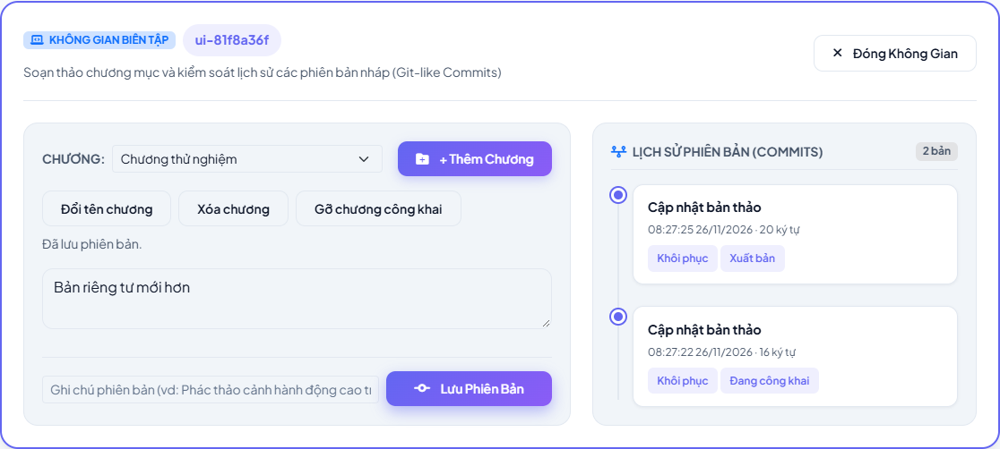
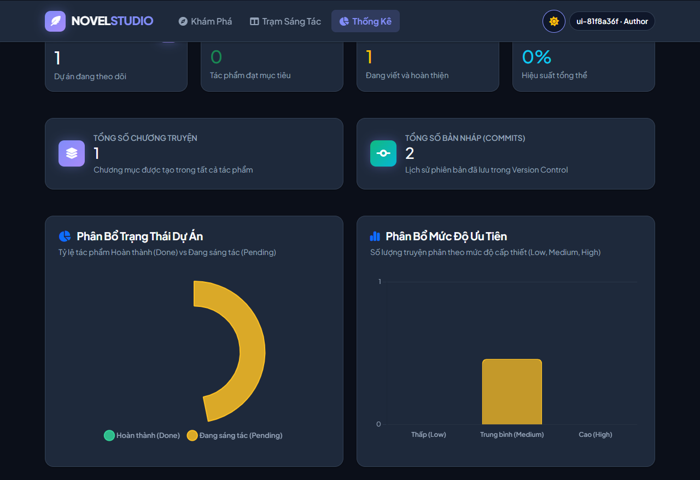

# Biên bản kiểm thử và đối chiếu rubric

Kiểm thử trên Windows ngày 26/11/2026. Dữ liệu dùng trong bài thử là tài khoản và tác phẩm giả lập. PostgreSQL 17.12, hai tiến trình FastAPI và Nginx 1.28 chạy thật, chỉ lắng nghe trên loopback. Bản Nginx thử nghiệm dùng địa chỉ loopback thay cho DNS của container. Trình duyệt là Chrome headless qua Playwright.

| Mốc | Phép kiểm tra đã chạy | Kết quả quan sát |
|---|---|---|
| A | Build Bootstrap, Font Awesome, Chart.js, SweetAlert2 và phông chữ. Kiểm tra đường dẫn nội bộ của ba trang. Khởi tạo với localStorage trống. | Build thành công. Không cần seed. Trang chủ của DB trống trả danh sách rỗng. |
| A | Tạo cấu hình từ mẫu, kiểm tra giá trị ngẫu nhiên và chạy Compose v2.39.4 `config -q`. | Mẫu tạo ba mật khẩu riêng. Compose chấp nhận cấu hình. Cổng host chỉ có ở gateway với bind localhost mặc định. |
| B | Migrations trên hai DB trống. Đăng ký và đăng nhập từ Chrome, tạo tác phẩm, tạo chương, lưu và tải lại trang. | Lịch sử và nội dung chương được đọc lại qua API từ PostgreSQL. Cookie phiên có HttpOnly. |
| B | Hai Author đọc/sửa chéo ở cấp tác phẩm, chương, phiên bản, xuất bản, import/export và thống kê. Thử role/owner do client khai báo, thiếu header CSRF, dùng lại cookie sau logout. | Quyền lấy từ phiên. Tài nguyên của người khác trả 404, export/thống kê chỉ chứa dữ liệu của chính chủ. Yêu cầu ghi thiếu header trả 403, cookie đã hủy trả 401. |
| C | Tìm kiếm, lọc ưu tiên/trạng thái, phân trang, CRUD, đổi bút danh, khôi phục phiên bản và gỡ công khai. | Giá trị đọc lại phù hợp. Khôi phục tăng số phiên bản. Bản nháp mới, ghi chú nội bộ và cập nhật mô tả chưa xuất bản đều được giữ riêng tư. |
| C | JSON sai cấu trúc lồng nhau, hai request nhập cùng backup đồng thời, xuất lại, so sánh nội dung và thời điểm. | Dữ liệu sai bị từ chối toàn bộ. Hai lần nhập hợp lệ trả tổng số thêm bằng một bản. Giữ thứ tự lịch sử, nội dung, ghi chú và thời điểm kể cả khi có offset múi giờ. Chương nhập từ trạng thái Published bắt đầu riêng tư. |
| C | Chrome ngắt request lưu, rồi làm mất phản hồi sau khi server đã commit. Hết phiên trong lúc soạn, đăng nhập lại trong cùng tab. | Ô soạn giữ nguyên. Thử lại sau mất phản hồi chỉ có một hàng phiên bản. Đăng nhập lại cùng tài khoản cho phép lưu tiếp. Nút nhập hai lần và xuất file trong dashboard hoạt động. |
| D | CLI tạo Admin, đăng nhập và xem danh sách tài khoản. Studio trỏ tới identity ngừng phục vụ. DB role của từng service kết nối vào DB kia. | Admin xem được tài khoản và chỉ thấy thư viện của mình. Studio trả 503 khi chưa xác minh được phiên. PostgreSQL từ chối cả hai kết nối chéo. |
| D | Trang thống kê sau khi lưu hai phiên bản, đổi theme, mở trang chủ bằng phiên khách và viewport 390 × 844. | Thống kê hiện đúng một chương và hai phiên bản. Khách đọc được đúng bản công khai. |
| D | Khởi động lại PostgreSQL và hai service trên Windows. Dùng pg_dump custom, chạy script khởi tạo database và pg_restore vào cluster riêng. | So sánh tất cả hàng trong cả hai database bằng biểu diễn JSON có thứ tự. Nội dung trùng khớp sau restart và sau phục hồi. |

### Ảnh từ trình duyệt

Ở lần rà soát cuối, mã được xuất từ Git index sang một thư mục sạch. Từ thư mục này, npm ci và build frontend thành công, Compose kiểm tra cấu hình thành công. Migrations chạy lại trên một cluster mới. Chrome với hồ sơ mới hiện thư viện công khai rỗng, sau đó cả hai bài smoke API và UI đều chạy thành công qua gateway localhost.

## Đối chiếu yêu cầu bài tập

Mười nhóm chức năng trong rubric được ánh xạ như sau.

| Nhóm | Vị trí chạy thử |
|---|---|
| Đăng ký, đăng nhập, đăng xuất, hồ sơ | Menu tài khoản trên cả ba trang và API Identity |
| Phân quyền | Admin → Danh sách tài khoản, Author → thư viện riêng |
| CRUD dữ liệu | Trạm Sáng Tác → tác phẩm, chương, lịch sử |
| Tìm kiếm, lọc, phân trang | Thanh bộ lọc và điều hướng trang trên dashboard |
| Thống kê | statistics.html và API Studio |

Cơ sở dữ liệu có sáu bảng nghiệp vụ với PK, FK trong từng database, uniqueness và migrations. File `examples/legacy-demo.json` cùng hai bài smoke cung cấp dữ liệu kiểm thử. Sơ đồ use case, ERD, phân tích nhu cầu và các API nằm trong [thiết kế hệ thống](full-stack.md). Các thao tác cài đặt, vận hành và kiểm thử lại nằm trong [README](../README.md).

## Phần còn cần kiểm chứng khi triển khai

Máy kiểm thử thiếu Docker Engine. Chưa chạy build image, DNS nội bộ Compose, startup/restart container hay hai script PowerShell sao lưu/phục hồi xuyên suốt qua Docker. Đã kiểm tra cú pháp script cùng các lệnh PostgreSQL tương ứng trên Windows. Cần chạy lại trên Docker Desktop từ volume thử trắng, đăng nhập bằng trình duyệt và kiểm tra dữ liệu sau `docker compose restart`.

LAN, thiết bị vật lý thứ hai, tunnel Internet, cookie Secure trên HTTPS và firewall chưa được bật thử. Kiểm tra viewport điện thoại đã dùng cùng máy chủ localhost. Để nộp bài theo toàn bộ rubric, nhóm còn cần chuẩn bị slide, video demo và phần trình bày/vấn đáp. Rubric gốc được giữ cục bộ.
